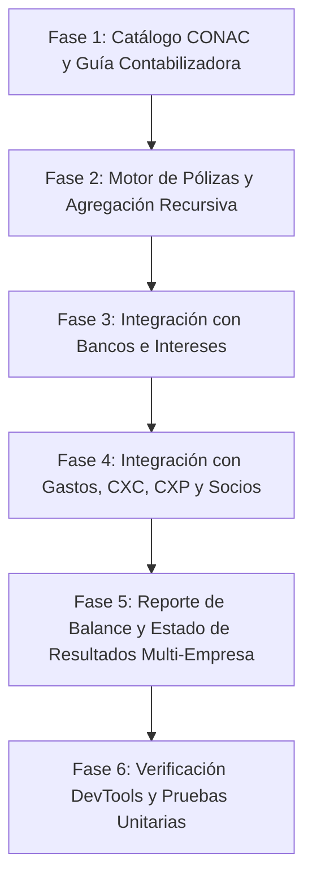

# Plan de Implementación: Sistema Contable, Motor de Pólizas (CONAC), Guía Contabilizadora y Balance Multi-Empresa

**Especificación:** [`specs/008-sistema-contable-polizas-conac/spec.md`](file:///c:/Users/carlo/Documents/desarrollo/JoseMXN/SGTSITA/specs/008-sistema-contable-polizas-conac/spec.md)  
**Metodología:** Spec-Driven Development (SDD)  
**Principio Fundamental:** Prohibido `migrate:fresh` o `db:wipe`, transacciones `DB::transaction()` obligatorias, Thin Controllers, validación estricta de partida doble y `es_afectable`.

---

## Fases de Implementación

---

### Fase 1: Arquitectura de Base de Datos y Catálogos Contables
1. **Migración `create_cat_cuentas_contables_table`:**
   - Campos: `id`, `id_empresa` (nullable), `codigo`, `nombre`, `nivel` (1 a 5), `cuenta_padre_id`, `rubro`, `naturaleza`, **`es_afectable`** (boolean), `activo`.
   - Índices para búsqueda rápida y jerarquía.
2. **Migración `create_guia_contabilizadora_table` (Matriz de Conversión):**
   - Campos: `id`, `id_empresa` (nullable), `evento`, `subtipo`, `tipo_poliza`, `cuenta_cargo_id`, `cuenta_abono_id`, `regla_dinamica`, `descripcion_asiento`, `activo`.
3. **Migración `create_polizas_and_movimientos_tables`:**
   - Tablas `polizas` y `poliza_movimientos` con relación opcional a `id_equipo`.
4. **Migración `create_balance_general_conceptos_cuentas_table`:**
   - Estructuración de renglones visuales del balance y estado de resultados vinculados a prefijos de cuentas CONAC.
5. **Migración en `cat_bancos_cuentas_movimientos`:**
   - Agregar columna `tipo_concepto` (`operativo`, `interes`, `traspaso`, `comision`) y `poliza_id`.
6. **Seeders:**
   - `CatCuentasContablesSeeder`: estructura base CONAC (niveles 1 a 3 globales `id_empresa = NULL`, subcuentas analíticas nivel 4 y 5 con `es_afectable = 1`).
   - `GuiaContabilizadoraSeeder`: reglas por defecto para eventos (`INTERES_BANCARIO`, `GASTO_OPERATIVO`, `GASTO_ANTICIPADO`, etc.).
   - `BalanceGeneralConceptosSeeder`: estructura visual alineada al modelo del PDF `TP 002`.

### Fase 2: Servicios de Dominio (Motor Contable y Recursividad)
1. **[`app/Services/ContabilidadService.php`](file:///c:/Users/carlo/Documents/desarrollo/JoseMXN/SGTSITA/app/Services/ContabilidadService.php):**
   - Algoritmo de agregación recursiva ascendente:
     - Suma movimientos de pólizas en cuentas nivel 5 (`es_afectable = 1`).
     - Propaga y acumula recursivamente hacia arriba a sus cuentas padre nivel 4 -> nivel 3 -> nivel 2 -> nivel 1.
     - Aplica naturaleza contable (Deudora: Debe - Haber; Acreedora: Haber - Debe).
     - Soporta filtro por una o múltiples empresas (`idsEmpresas`) y por unidad (`idEquipo`).
2. **[`app/Services/PolizaService.php`](file:///c:/Users/carlo/Documents/desarrollo/JoseMXN/SGTSITA/app/Services/PolizaService.php):**
   - Creación de pólizas con validación de:
     - Partida doble (`total_debe === total_haber`).
     - Solo cuentas con `es_afectable === 1`.
   - Consulta y aplicación de la Guía Contabilizadora (`resolverAsientoPorEvento($evento, $idEmpresa, $parametros)`).

### Fase 3: Integración de Bancos y Separación de Intereses
1. **Modal de Bancos:**
   - Permitir capturar abono con `tipo_concepto = 'interes'`.
2. **Disparo Contable en Bancos:**
   - Al registrar abono por interés, invocar la Guía Contabilizadora para generar la póliza automática:
     - Cargo a Bancos (cuenta analítica del banco).
     - Abono a Productos Financieros / Intereses Ganados (`4.3.1.1`).
3. **Listado y Filtro en Bancos:**
   - Visualización de la etiqueta `Interés` y filtro por tipo en el módulo de bancos.

### Fase 4: Integración con Gastos, Socios y Cotizaciones
1. **Gastos:**
   - Al registrar o autorizar un gasto, invocar `PolizaService` aplicando la guía (Gasto Operativo o Gasto Diferido/Anticipado según corresponda).
2. **Socios:**
   - Al emitir el cierre mensual de utilidades, emitir póliza de provisión contable de utilidad y reparto.
3. **Cotizaciones / Viajes:**
   - Emisión de póliza de provisión de flete (Clientes CXC vs Ingresos por Servicios).

### Fase 5: Reporte de Balance General y Estado de Resultados Multi-Empresa (Modelo TP-002)
1. **Controlador Contabilidad:**
   - Si `es_admin = 1`: habilita selector múltiple de empresas (o "Todas las Empresas").
   - Si `es_admin = 0`: fija la empresa actual.
   - Selector de Unidad/Camión (`id_equipo - marca`) o Consolidado.
   - Selector de Fecha de Corte.
2. **Vista Blade (`resources/views/contabilidad/balance/index.blade.php`):**
   - Formato idéntico al modelo del PDF:
     - Columna Izquierda: ACTIVO (Bancos, CXC, Préstamos, Gastos por comprobar, Equipo de transporte, Chasis, Gastos pagados por anticipado).
     - Columna Derecha: PASIVO (Préstamos a pagar, Cuentas por pagar, Acreedores) y PATRIMONIO (Resultado ej anterior, Resultado del ejercicio, Reparto).
     - Pie: ESTADO DE RESULTADOS (Ingresos por fletes, Intereses ganados independientes, Gastos del periodo, Utilidad neta cuadrando con Patrimonio).
3. **Exportación:**
   - Botones para Impresión, PDF y Excel.

### Fase 6: Pruebas y Validación Final
1. Pruebas unitarias de cuadratura contable y recursividad de cuentas padre-hijo.
2. Pruebas con Chrome DevTools simulando el camión TP-002 y validando los datos del PDF.
3. Actualización de `MEMORY.md`.
